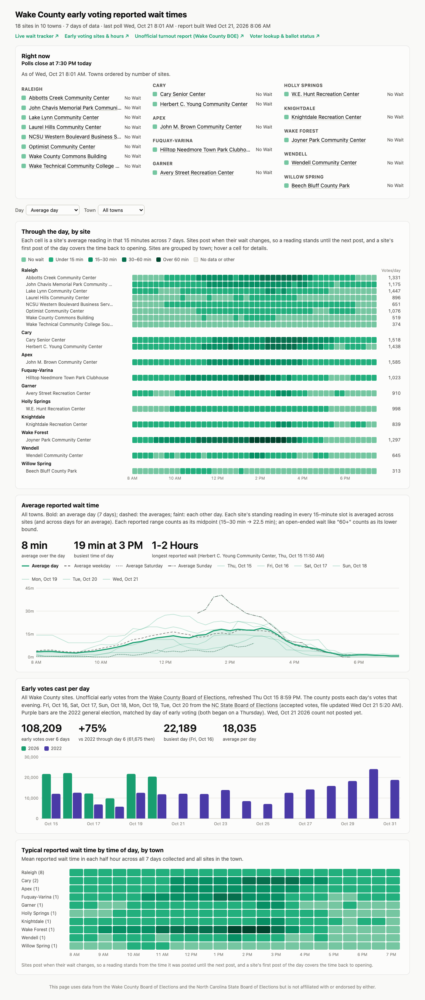

# Wake County early voting reported wait times

Tracks the reported wait time at each of Wake County, NC's early voting sites during
the 2026 General Election (Oct 15 – Oct 31, 2026) and builds a report from it.

The Wake County Board of Elections publishes each site's current wait on a
[live wait tracker](https://airtable.com/appAL6KsUEvshj4br/shrQkIIFla4bjdGzh)
(linked from [wakevotesearly.com](https://wakevotesearly.com)), but it only shows
the current wait, with no history. These scripts poll the tracker every few
minutes, save each reading to a CSV file, and turn that history into a report.
The report also includes daily early-vote turnout from the
[Wake County Board of Elections](https://www.wake.gov/departments-government/board-elections/election-information/2026-general-election),
filling in from the
[NC State Board of Elections](https://www.ncsbe.gov/results-data/absentee-and-provisional-data).

This is an independent project and is not affiliated with the Wake County Board
of Elections or the NC State Board of Elections. For current waits, use the
county's tracker.

## Latest report

**[Open the interactive report](https://rtphokie.github.io/wakeearlyvotewait/)**
for hover details, filters and links. The same report is in
[`docs/index.html`](docs/index.html).

The report includes:

- **Right now:** each site's latest wait, grouped by town. Site names link to
  directions.
- **Through the day, by site:** a site-by-time heatmap with each site's early
  votes for the day.
- **Average reported wait time:** the average across sites over the day.
- **Early votes cast per day:** turnout from the county, posted the same
  evening.
- **Typical wait by time of day, by town:** averaged over every day collected.

The Day picker opens on an **average day**: each site's reading in every
15-minute slot, averaged over every day collected. Pick a date to see that day.

## Files

| File | What it is |
|---|---|
| `wake_wait_monitor.py` | Polls the county tracker, prints a table, and appends each reading to a CSV |
| `run_during_early_voting.py` | Keeps the monitor running only during early voting hours |
| `visualize_waits.py` | Builds the HTML report from one or more CSVs, plus county and State Board turnout |
| `publish_report.sh` | Rebuilds and pushes the report; run every 20 minutes by launchd |
| `2026-10-15_to_2026_10-31.csv` | Every reading collected, starting Thu Oct 15 at 8:45 AM |
| `docs/index.html`, `docs/report.png` | The latest report and a screenshot of it |
| `RUNNING.md` | How to run everything |

All scripts use only the Python 3.11+ standard library. Reading the county's turnout
PDF also needs `pdftotext` (`brew install poppler`). See [RUNNING.md](RUNNING.md).

## The data

Each CSV row is one site at one poll:

| Column | Meaning |
|---|---|
| `polled_at` | When the monitor read the tracker (UTC, ISO 8601) |
| `site` | Early voting site name |
| `wait` | The wait as the tracker reported it: `No Wait`, `5-15 Minutes`, `15-30 Minutes`, `30-60 Minutes`, `1-2 Hours`, … |
| `site_updated_at` | When the site last updated its reported wait time (UTC) |
| `address` | Site address |

Things to know when using the data:

- **Waits are ranges and are only as current as the site's last update.** Sites
  update every 10–90 minutes.
- **A reading stands until the site posts a new one,** so the report carries
  each reading forward through stretches with no updates.
- **Turnout counts in-person early votes per site per day.** They come from
  the county's unofficial early voting turnout PDF, refreshed each evening. Any
  day that file doesn't have comes from the State Board's statewide absentee
  file, which counts accepted ballots and is posted the next morning, so the two
  can differ slightly. Only the per-site counts are kept. The State Board file
  lists individual voters, so both files are downloaded to `ncsbe_cache/` and
  never committed.

## License

[MIT](LICENSE) for the code. The wait-time data comes from the Wake County
Board of Elections' public tracker, and turnout comes from the Wake County and
NC State Board of Elections' public files.
